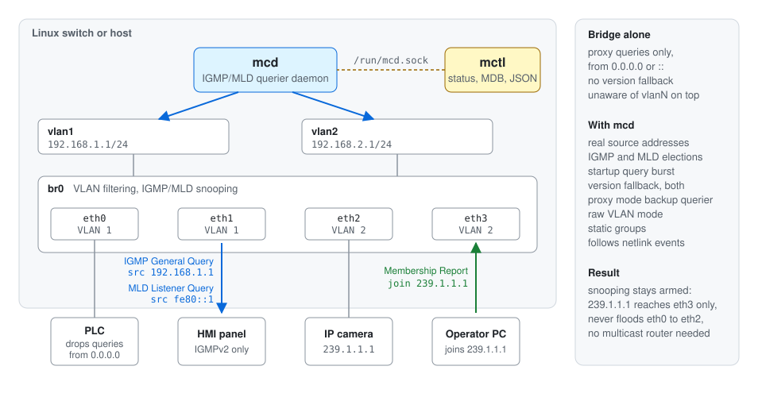
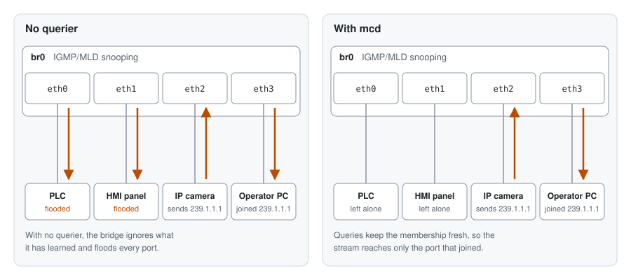
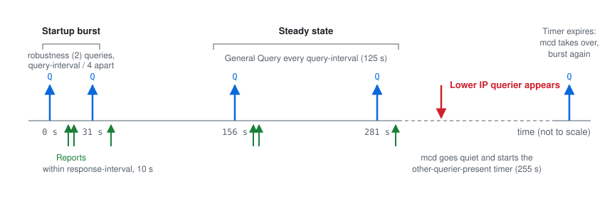

Multicast Querier for the Linux Bridge
======================================
[![ISC license][license-badge]][license] [![Build status][build-badge]][build] [![Coverity Scan status][coverity-badge]][coverity]

`mcd` is a small daemon that turns a Linux bridge into a proper IGMP
and MLD querier.  It sends queries from a real address, takes part in
querier elections, falls back from IGMPv3 to v2 or v1 and from MLDv2 to
v1 when old gear shows up, and follows interfaces and addresses as they
come and go, no restart needed.  It ships with `mctl`, a tool that
shows what the querier and the bridge are up to, in plain text or JSON.

`mcd` is the multicast querier in [Infix OS][Infix].  It is written in
plain C with no runtime library dependencies, and ISC licensed.

The full reference is in the man pages: [mcd(8)][], [mcd.conf(5)][]
and [mctl(8)][].

Why?
----

The Linux bridge has IGMP/MLD snooping, with per-VLAN settings and a
built-in querier.

– So why do we need `mcd`?

Because snooping only works while there is a querier on the LAN.
Without one, the bridge does not trust what it has learned and floods
all multicast to every port.  Many industrial networks have no
multicast router to be the querier, only switches doing their best to
keep multicast off low-capacity links.  And when the querier they do
have goes away, the bridge starts flooding four minutes and fifteen
seconds later, once its other querier present timer runs out.

The bridge's own querier can stand in, but it has limits:

- It runs one fixed protocol version, IGMPv2 and MLDv1 by default.  Per
  RFC, a LAN should run the newest version and drop to an older one
  only while a host that needs it keeps talking.
- Its IGMP queries come from `0.0.0.0` unless it is set to use its own
  address.  Some PLCs and other industrial devices ignore such proxy
  queries.  Their memberships then expire, and they quietly lose their
  stream while everyone else keeps theirs.  Good luck getting the
  vendor to fix a ten year old firmware.
- When it does use its own address on a VLAN filtering bridge, it picks
  one address for all VLANs.  With an address on both `vlan10` and
  `vlan20`, the queries on VLAN 20 come from the VLAN 10 subnet.

`mcd` fills that gap.  It queries from the right address on each
interface, follows the election rules, falls back and returns as hosts
come and go, and keeps snooping armed on LANs that have no multicast
router.

Features
--------

- Queries go out from the address of each interface, the right one on
  every VLAN, so devices that ignore proxy queries keep answering.
- One querier per address family on every interface: IGMP from the
  interface address, MLD from its link-local address, each with its
  own election.
- Querier election per RFC 2236, 3376, 2710 and 3810, lowest address
  wins.  When a better querier shows up, `mcd` backs off and watches
  the other querier timer.  When it expires, `mcd` takes over again.
- Startup query burst.  On assuming the querier role, `mcd` sends
  `robustness` queries spaced `query-interval / 4` apart, per RFC 3376
  §8.6 and §8.7.  A host that missed the first query gets another one
  within half a minute instead of waiting a full query interval.
- Version fallback.  Starts at IGMPv3 and MLDv2, drops to the older
  versions when such hosts appear, and returns when they go quiet.
- Proxy mode, a backup querier that sends from `0.0.0.0` or `::` and can
  never win an election.  Used automatically when an interface has no
  address.
- Raw VLAN mode.  Run a querier directly on a VLAN of a filtering
  bridge, no `vlanN` interface required.
- Static groups, joined in the kernel so they never time out.
- `mctl` shows interface and querier status, group memberships, router
  ports per bridge, and the bridge MDB in a readable form.  JSON output
  for scripts, a watch mode for humans.

One querier's life on one interface:

Quick start
-----------

Build and install, see [Building](#building) for details:

    ./autogen.sh      # only when building from git
    ./configure && make && sudo make install

Enable the querier in `/etc/mcd.conf`, on the bridge itself or on the
VLAN interfaces on top of it:

    iface br0 enable
    iface vlan1 enable
    iface vlan2 enable

Start the daemon, and look at what it does:

    sudo mcd -n -l info
    mctl show

Every interface in the system is probed at start, and again on
`SIGHUP`, which also re-reads the configuration file.

Configuration
-------------

The configuration file is `/etc/mcd.conf`.  Without it, `mcd` is
passive on all interfaces.  A typical setup enables the queriers on the
VLAN interfaces of a bridge and leaves the rest at their defaults:

    # /etc/mcd.conf
    iface vlan1 enable
    iface vlan2 enable igmpv2 mldv1

The sections below cover the common cases.  Every keyword, its range
and default is in [mcd.conf(5)][].

### Bridge or VLAN interface

The interface can be a VLAN interface on top of the bridge, or the
bridge itself:

    iface vlan1 enable
    iface br0 enable

Use the bridge directly when it has no VLAN filtering, or when the VLAN
you care about is its untagged default.  For other VLANs of a filtering
bridge, see [Raw VLAN mode](#raw-vlan-mode).

### IGMP and MLD

Each enabled interface runs both an IGMP and an MLD querier.  IGMP
queries use the interface address as source, MLD queries its
link-local address, and `mcd` competes in both elections.  To run only
one of them:

    iface vlan1 enable mld off

Both start at the newest version, IGMPv3 and MLDv2, and fall back on
their own when an older host shows up.  The `igmpv2` and `mldv1` flags
in the example above start an interface out at the older version.

### Proxy mode

    iface vlan1 enable proxy-mode

In proxy mode `mcd` sends from `0.0.0.0`, or `::` for MLD, and therefore
always loses elections.  It only queries when no real querier is
around, which makes it a safe backup on LANs that normally have a
multicast router.

> **Note:** an interface without an address runs in proxy mode
> whether you asked for it or not.  When an address shows up, `mcd`
> switches to standard mode by itself.

### Raw VLAN mode

A VLAN filtering bridge with no `vlanN` interface on top can still get
a querier.  `mcd` injects tagged frames straight into the bridge, and
is always in proxy mode here:

    iface br0 vlan 42 enable

### Static groups

    iface vlan1 enable static-group 239.1.1.1 static-group ff05::1

`mcd` joins each group in the kernel, which then answers queries for it
like any other host.  On a bridge this gives the group a permanent host
membership in the MDB, so it is always forwarded to the bridge itself.
The membership stays until the group is removed from the configuration
or `mcd` exits.  A link flap or a reload does not touch it.

### Timers

The query interval, response time and robustness are global settings,
and the query interval can also be set per interface:

    global-query-interval 125
    iface vlan1 enable query-interval 30

The defaults follow the RFCs and suit most networks.

Inspecting with mctl
--------------------

`mctl` talks to the daemon over a UNIX socket.  Run it without
arguments for an overview:

    $ mctl
    Multicast Overview
    Query Interval (default): 125 sec
    Router Timeout          : 255
    Fast Leave Ports        :
    Router Ports            : eth3
    Flood Ports             :

    Interface       VID  Proto  Querier                      State  Interval  Timeout  Ver
    vlan1                IGMP   192.168.1.1                     Up       125     None    3
    vlan1                MLD    fe80::7a4c:9bff:fe12:3456       Up       125     None    2
    vlan2                IGMP   192.168.2.1                     Up       125     None    3
    vlan2                MLD    fe80::7a4c:9bff:fe12:3456       Up       125     None    2
    br0              42  IGMP   0.0.0.0                         Up       125     None    3
    br0              42  MLD    ::                              Up       125     None    2

    Bridge          VID  Multicast Group       Ports
    br0               2  239.1.1.1             eth3

The parts are also available on their own, as `show interfaces`,
`show groups`, `show router-ports` and `show mdb`.  Add `json` to any
`show` command for machine readable output, and `-m` to keep it
updating like `watch(1)`.  All commands and options are in
[mctl(8)][].

> **Note:** collecting bridge status needs `jq` and the iproute2 tools
> `ip` and `bridge`.  The BusyBox versions are not enough.  Run
> `mctl check` to confirm.

The IPC protocol is plain text, one command per connection, so other
programs can use it without `mctl`:

    echo "show igmp json" | socat - UNIX-CONNECT:/run/mcd.sock

Running the daemon
------------------

`mcd` detaches and logs to syslog by default.  For a first look, run
it in the foreground with more logging:

    sudo mcd -n -l info

`SIGHUP` reloads the configuration and probes the interfaces again.
To check a configuration file before loading it, run `mcd -t -f FILE`
as any user.  To run several instances, give each its own identity
with `-i NAME`, which also names its configuration file, PID file and
IPC socket, and point `mctl -i NAME` at the one you want.  The
options, signals and files are in [mcd(8)][].

Building
--------

`mcd` uses GNU autotools.  From a release tarball:

    ./configure
    make
    sudo make install

From git, run `./autogen.sh` first.  That needs `autoconf`, `automake`
and `bison` (or another yacc).

Options worth knowing:

| Option                 | Effect                                                     |
|------------------------|------------------------------------------------------------|
| `--with-group=NAME`    | Group owner of `/run/mcd.sock`, default `root`.  Use e.g. `wheel` to let admins run `mctl` without `sudo` |
| `--enable-test`        | Build the test suite, see [Testing](#testing)              |
| `--with-bash-completion-dir=DIR`, `--with-zsh-completion-dir=DIR` | Where to install the `mctl` completion scripts, default under `DATADIR`, `no` to skip |
| `--prefix=`, `--sysconfdir=` | The usual, defaults are `/usr/local` and `/etc`      |

Configure prints a summary at the end, check it before running `make`.

Testing
-------

The test suite runs in network namespaces, so it needs `unshare`,
`socat`, `jq`, `tshark` and iproute2.  Build with `--enable-test` and
run:

    make check

For poking at `mcd` by hand there are helper scripts in `util/` that
set up a namespace with a bridge and a few veth pairs.  See
[util/README.md](util/README.md).

Origin and license
------------------

`mcd` began in 2021 as [querierd][], written by Joachim Wiberg at
Westermo with DNA strands from [`mrouted`][mrouted].  It gave the Linux
bridge in WeOS 5 a querier that industrial end devices would actually
answer.  Jacques de Laval added proxy mode to querierd at Westermo and
made four of its releases.  Westermo's last release was v0.10, in May
2023.

In 2024 its original author adopted it as `mcd` in [KernelKit][], the
home of [Infix OS][Infix] and the place where Open Source projects from
industrial networking are picked up and carried on.  Version 2.0
replaced the last of the `mrouted` code, and version 3.0 added the MLD
querier.  `mcd` is licensed under the [ISC license][license].

[mcd(8)]:      https://man.troglobit.com/man8/mcd.8.html
[mcd.conf(5)]: https://man.troglobit.com/man5/mcd.conf.5.html
[mctl(8)]:     https://man.troglobit.com/man8/mctl.8.html
[querierd]:  https://github.com/westermo/querierd
[mrouted]:   https://github.com/troglobit/mrouted
[KernelKit]: https://kernelkit.org
[Infix]:     https://github.com/kernelkit/infix
[license-badge]:  https://img.shields.io/badge/License-ISC-blue.svg
[license]:        https://en.wikipedia.org/wiki/ISC_license
[build-badge]:    https://github.com/kernelkit/mcd/actions/workflows/build.yml/badge.svg
[build]:          https://github.com/kernelkit/mcd/actions/workflows/build.yml/
[coverity-badge]: https://scan.coverity.com/projects/30099/badge.svg
[coverity]:       https://scan.coverity.com/projects/30099
